# Guía de uso — Administradora

> Lectura rápida: ~10 minutos. Antes, lee [Primeros pasos](common.md) y la [guía de la cajera](cashier.md): la administradora puede hacer todo lo que hace la cajera (**Registrar servicio**, **Vender prenda**, **Cobrar**, aprobar solicitudes de cambio).

**Tu menú lateral:**

- **Principal:** Tablero
- **Operaciones:** Citas · Pedidos grandes · Productos · Historial
- **Personas:** Empleados
- **Finanzas:** Nómina
- **Gestión:** Catálogo · Ausencias · Analytics · Configuración

---

## 1. Tablero y analítica

Al entrar llegas a **Analytics**, el resumen del negocio. Elige el periodo arriba: **Hoy**, **Esta semana** o **Este mes**.

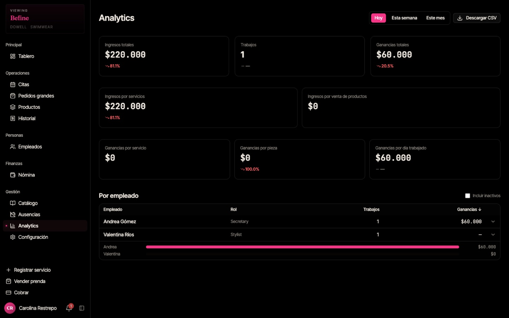

- **Ingresos totales**, **Trabajos** (servicios cobrados) y **Ganancias totales** (lo que se debe al equipo). El porcentaje en rojo o verde compara con el periodo anterior.
- **Ingresos por servicios** e **Ingresos por venta de productos**.
- **Ganancias por servicio** (comisiones), **por pieza** (confección) y **por día trabajado** (tarifa diaria).
- **Por empleado:** trabajos y ganancias de cada persona. Toca la flecha para ver el detalle.
- **"Descargar CSV"** exporta los datos para Excel.

---

## 2. Empleados

Menú → **Empleados**. Filtra por rol y activa **"Mostrar inactivos"** para ver las personas desactivadas.

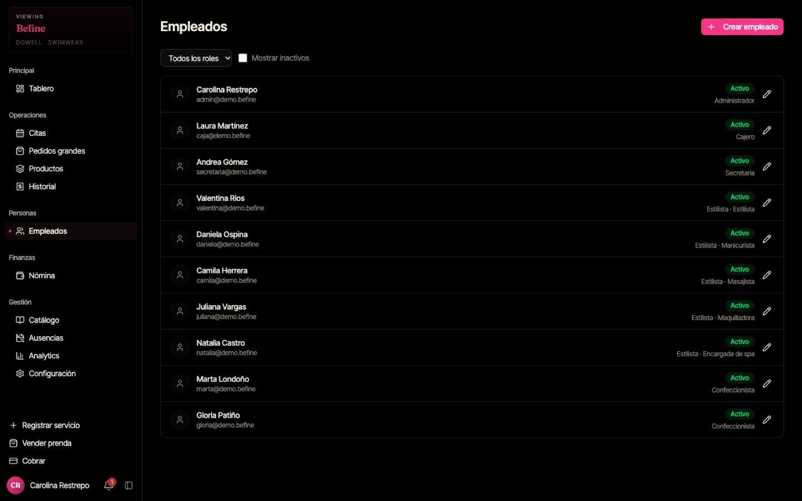

### Crear un empleado

1. **"Crear empleado"**.
2. **Nombre completo** y **Correo electrónico**.
3. **Rol:** Cajero, Administrador, Secretaria, Estilista o Confeccionista.
4. Si es estilista, elige el **Tipo de estilista** (Estilista, Manicurista, Masajista, Maquilladora, Encargada de spa).
5. **Días de trabajo esperados por semana** y fecha de cumpleaños.
6. **Contraseña temporal (opcional):** si la dejas vacía, la persona recibe un correo para crear la suya.
7. **"Crear empleado"**.

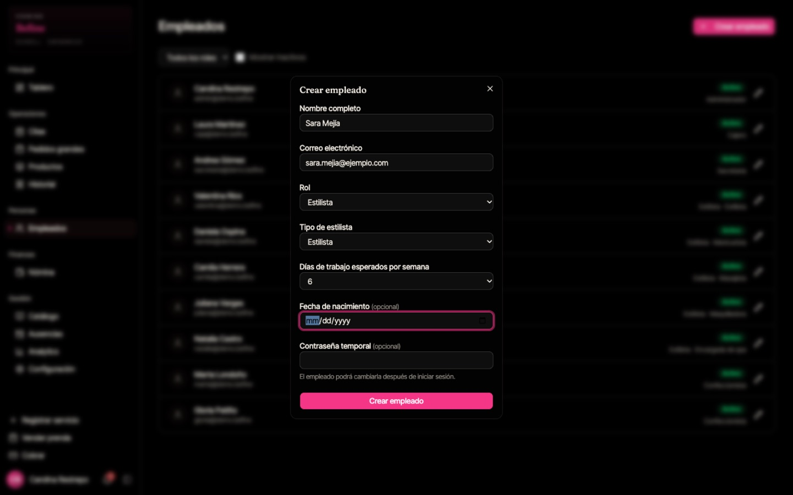

> Cuando alguien deja de trabajar, **desactívalo** (no lo borres). Se cierra su sesión y no puede volver a entrar, pero su historial se conserva. Antes de desactivarlo, liquida su nómina pendiente.

---

## 3. Aprobar piezas terminadas

Cuando una confeccionista marca una pieza como **Listo**, queda pendiente de tu aprobación.

1. Menú → **Productos**. Baja hasta **Piezas para aprobar**.
2. Revisa la pieza y toca **"Aprobar"**.
3. Confirma en **¿Aprobar esta pieza?** → **"Aprobar"**.

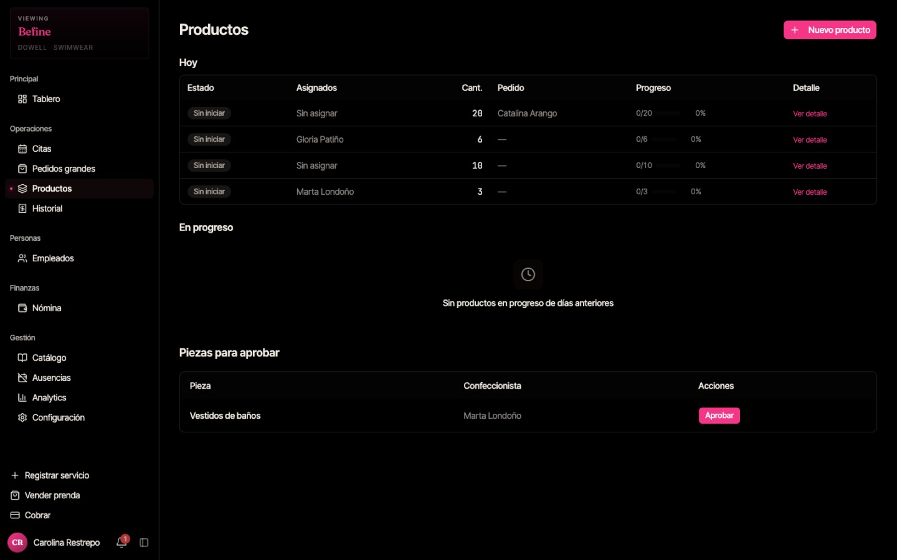

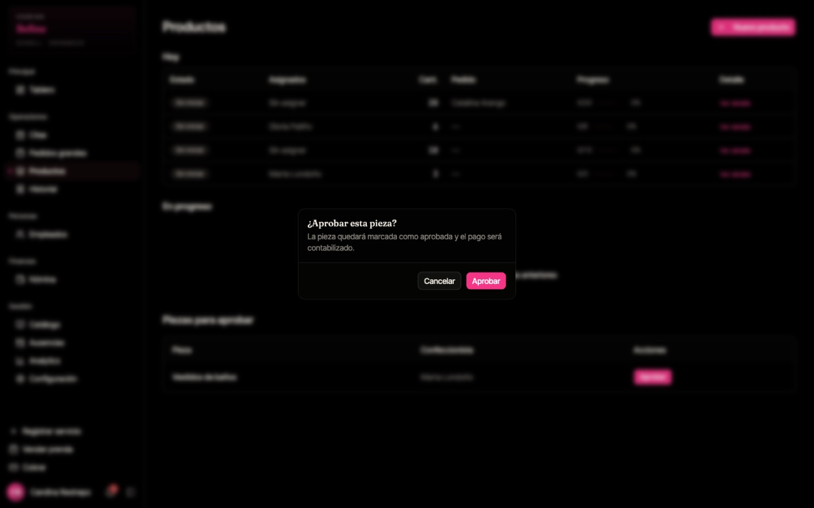

> Solo las piezas aprobadas cuentan para las ganancias de la confeccionista. Los productos que tú creas quedan aprobados automáticamente.

Para crear productos y seguir su avance, consulta la [guía de la secretaria](secretary.md#5-productos-trabajo-para-el-taller).

---

## 4. Historial de tickets

Menú → **Historial**: todos los tickets cobrados por día laboral, con clienta, empleada, servicio, método de pago y total.

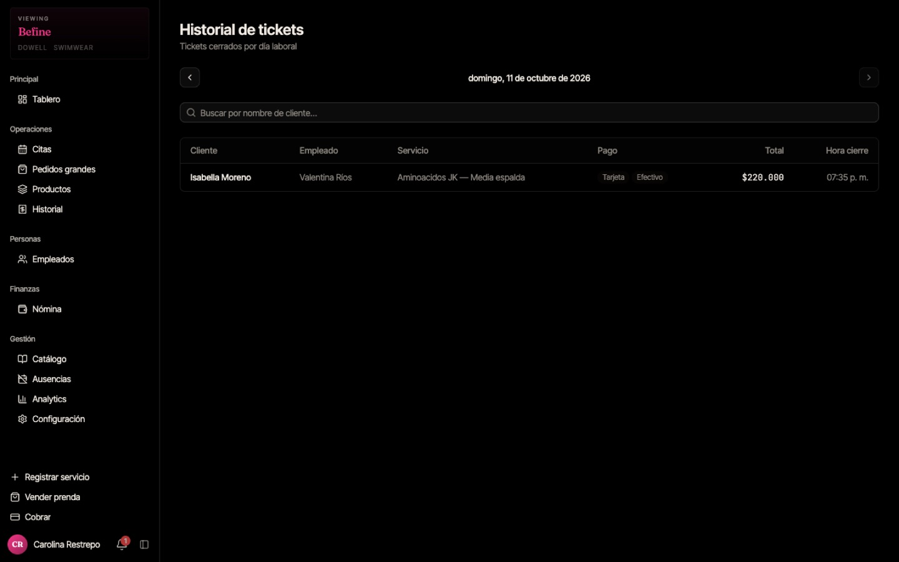

---

## 5. Nómina (liquidar y pagar)

Menú → **Nómina**. Arriba ves quién tiene ganancias **sin liquidar** y desde qué fecha, y el estado de los últimos 14 días laborales.

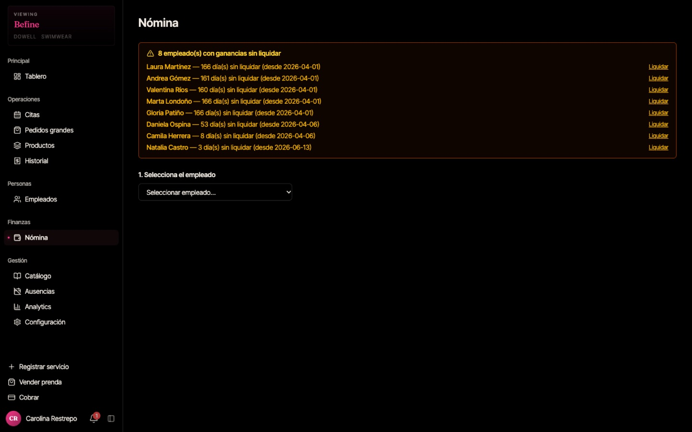

1. Toca **"Liquidar"** junto a la persona (o elígela en **1. Selecciona el empleado**).
2. **2. Selecciona los días laborales** que vas a pagar.
   - **Debes pagar siempre desde el día pendiente más antiguo.** Si te saltas días anteriores, el sistema no deja registrar el pago.
   - **"Seleccionar todos los días"** marca todo lo pendiente.
3. Toca **"Calcular ganancias (N días)"**.

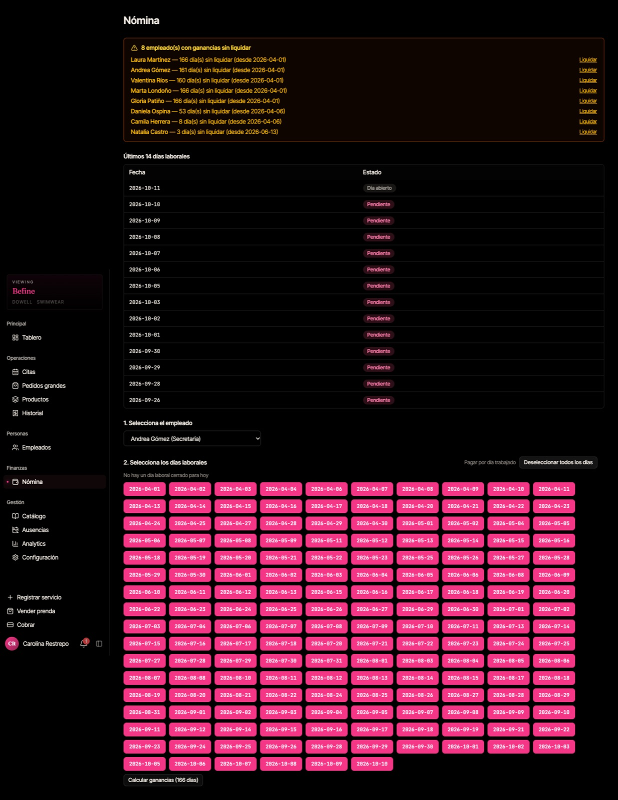

4. En **3. Revisa y confirma el pago** verás el detalle:
   - Estilistas: cada servicio con su comisión.
   - Confeccionistas: cada pieza aprobada.
   - Secretaria: días trabajados × tarifa diaria.
5. Revisa el **Total calculado**. **Monto a pagar** viene lleno con ese total; si pagas otro valor, explica el motivo.
6. Elige el **Método de pago**, agrega **Notas** si quieres y toca **"Confirmar pago"**.

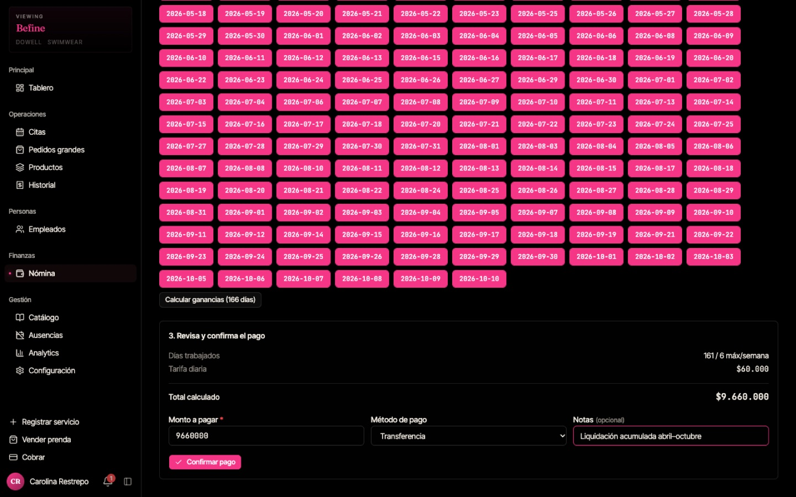

7. Confirma en **¿Confirmar el pago?**. Esta acción es **permanente**.

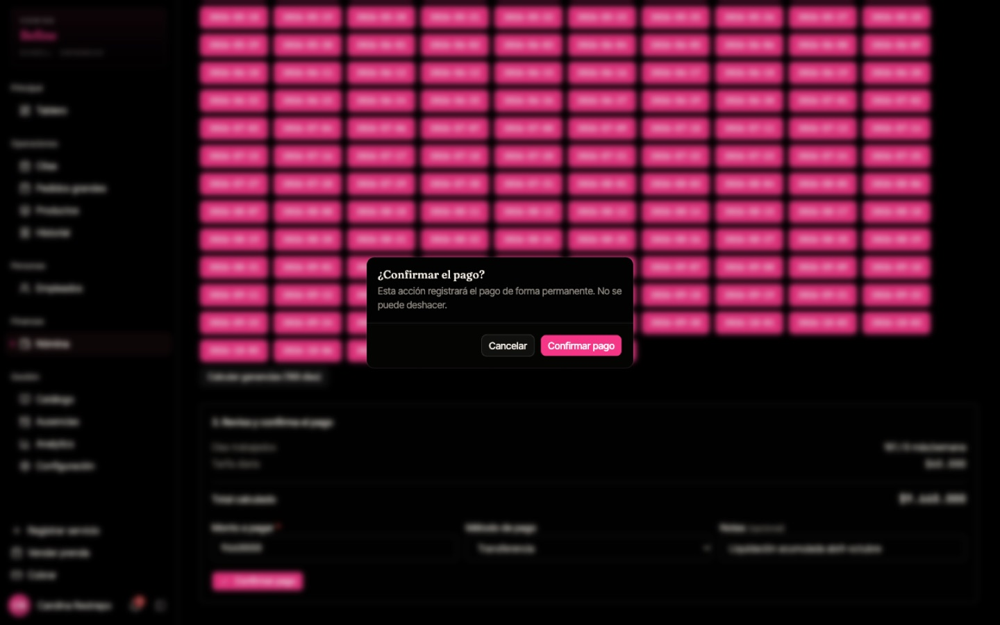

> **Si al confirmar no pasa nada**, cierra el mensaje con **"Cancelar"** y lee el aviso en rojo debajo del formulario (por ejemplo, _"Hay días anteriores sin pagar para este empleado. Liquida primero los pendientes."_).
> El sistema no permite pagar dos veces los mismos días.

---

## 6. Catálogo

Menú → **Catálogo**. Tiene dos pestañas: **Servicios** y **Piezas de confección**.

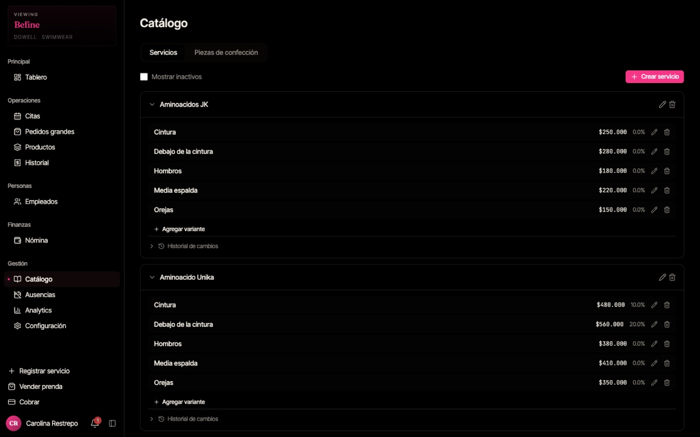

### Crear un servicio

1. **"Crear servicio"** → **Nombre del servicio** y **Descripción** (opcional).
2. Cada **variante** tiene nombre, **precio** (ej. 45000) y **% de comisión** de la estilista (ej. 40).
3. **"Agregar variante"** para más opciones (ej. _Dama_ / _Caballero_).
4. **"Crear"**.

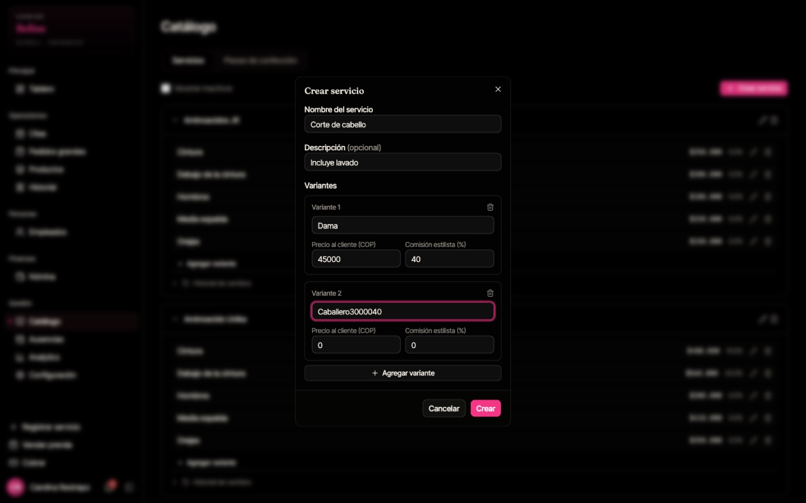

> **Revisa la comisión de cada variante.** Si queda en 0 %, la estilista no gana nada por ese servicio.
> Para dejar de ofrecer un servicio, **desactívalo** en lugar de borrarlo. Los cambios de precio no afectan los tickets ya registrados.

En **Piezas de confección** se definen las prendas, sus variantes, el pago por pieza a la confeccionista y el precio de venta.

---

## 7. Ausencias y vacaciones

Menú → **Ausencias**. El calendario muestra el mes; toca un día para registrar una ausencia.

1. Elige el **Empleado**.
2. **Tipo:** Vacaciones, Ausencia justificada o Falta.
3. **Nota** (opcional) → **"Guardar"**.

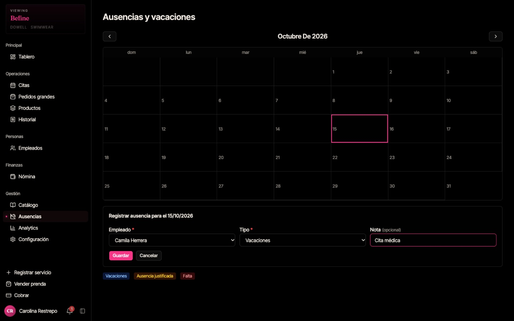

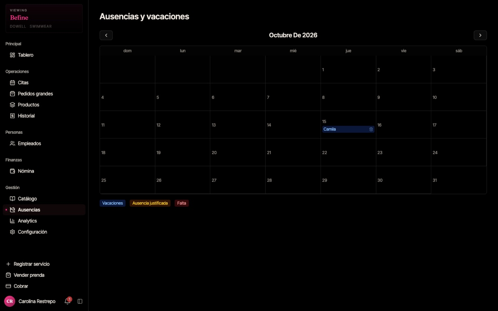

> Las ausencias afectan el cálculo de la tarifa diaria en la nómina.

---

## 8. Configuración

Menú → **Configuración**. Cambia una opción y toca **"Guardar cambios"**.

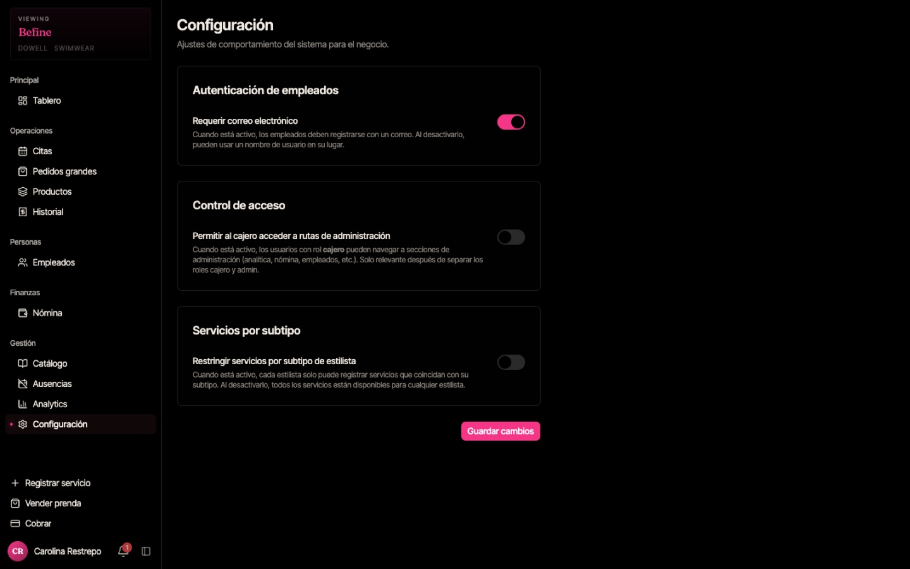

- **Requerir correo electrónico:** si lo desactivas, el equipo puede entrar con nombre de usuario.
- **Permitir al cajero acceder a rutas de administración:** da a la cajera acceso a analítica, nómina, empleados, etc. Actívalo solo si confías esas tareas a la cajera.
- **Restringir servicios por subtipo de estilista:** cada estilista solo puede registrar los servicios de su especialidad.

---

## Rutina recomendada

| Cuándo        | Tarea                                                                  |
| ------------- | ---------------------------------------------------------------------- |
| Cada día      | Revisar que la cajera abra y cierre el día con **0 tickets abiertos**. |
| Cada día      | Aprobar piezas terminadas en **Productos**.                            |
| Cada semana   | Liquidar la **Nómina** desde el día pendiente más antiguo.             |
| Cada mes      | Revisar **Analytics** y exportar el CSV.                               |
| Cuando cambie | Actualizar precios y comisiones en el **Catálogo**.                    |
