# Guía de uso — Cajera

> Lectura rápida: ~8 minutos. Antes, lee [Primeros pasos](common.md).

La cajera abre y cierra el día, cobra los servicios, registra ventas de prendas y aprueba las solicitudes de cambio de las estilistas. Trabaja en el computador de caja.

**Tu menú lateral:** Tablero · Citas · Pedidos grandes · Historial · Clientes. Abajo tienes tres botones rápidos: **Registrar servicio**, **Vender prenda** y **Cobrar**.

---

## 1. Abrir el día (al llegar)

Sin un día abierto nadie puede registrar servicios ni cobrar.

1. Inicia sesión → llegas a **Tablero** (pantalla _Cajero_).
2. Arriba a la derecha verás **Día cerrado**. Toca **"Abrir día"**.

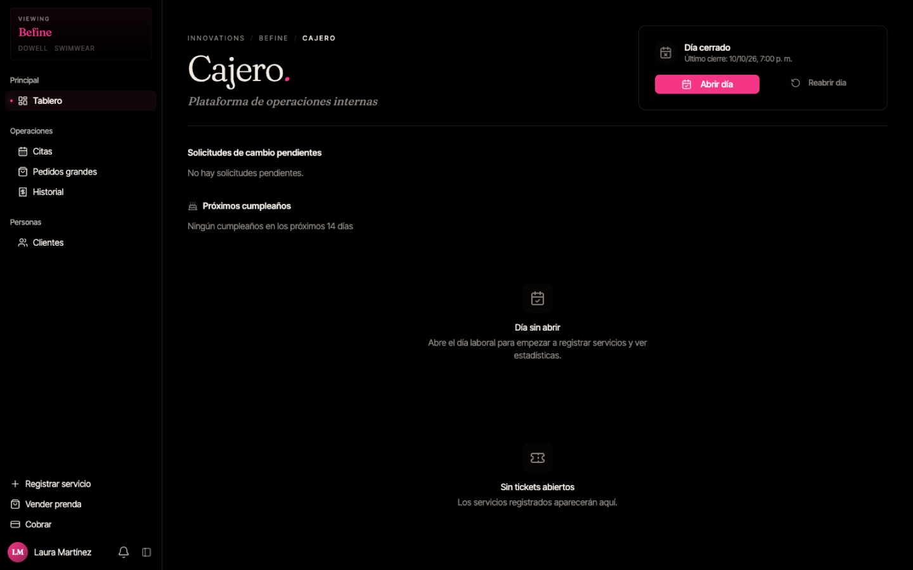

3. Espera unos segundos: el recuadro cambia a **Día abierto** con la hora de apertura, y aparecen los indicadores del día.

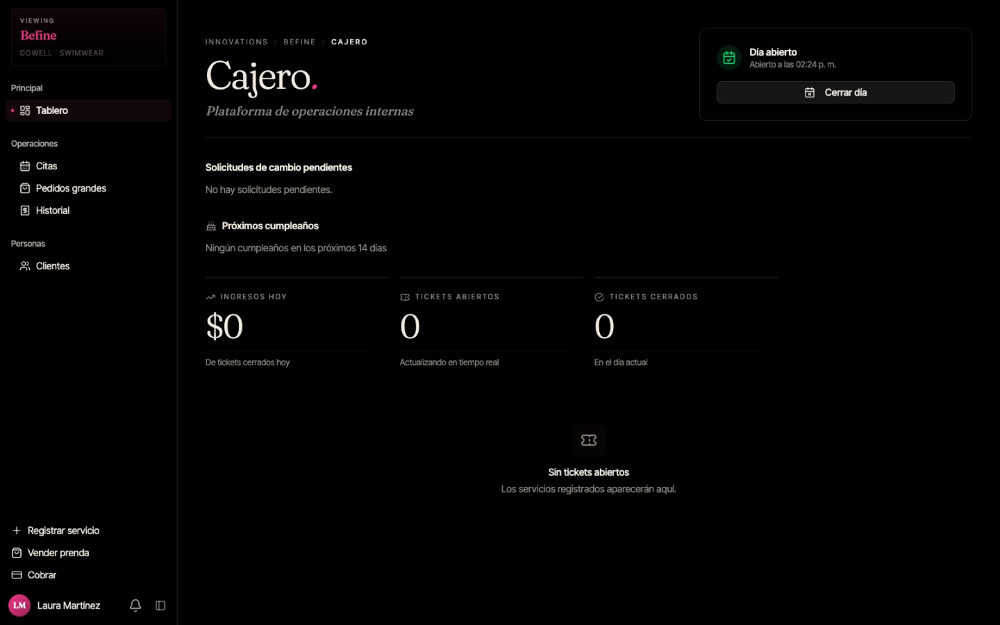

> **Reabrir día:** si cerraste el día por error, el botón **"Reabrir día"** vuelve a abrir el último día cerrado.

---

## 2. Leer el Tablero

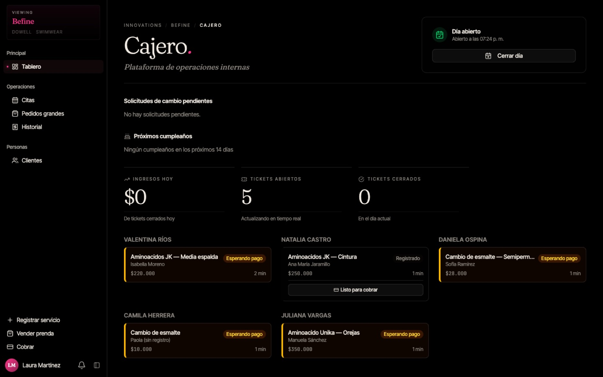

- **Ingresos hoy:** total cobrado en el día.
- **Tickets abiertos:** servicios registrados que aún no se han cobrado. Se actualiza solo.
- **Tickets cerrados:** servicios ya cobrados.
- Debajo aparecen los tickets agrupados **por estilista**:
  - **Registrado:** la estilista aún está atendiendo. Si la clienta ya terminó, puedes tocar **"Listo para cobrar"** tú misma.
  - **Esperando pago** (borde amarillo): listo para cobrar.
- **Solicitudes de cambio pendientes:** ver la sección 6.
- **Próximos cumpleaños:** clientas que cumplen años en los próximos 14 días.

---

## 3. Cobrar

1. Toca **"Cobrar"** (botón de abajo a la izquierda). La ventana puede tardar unos segundos en cargar.
2. En **Tickets seleccionados** aparecen **todos** los tickets que están esperando pago, ya marcados.
   **⚠️ Desmarca los que no son de la clienta que está pagando.** Revisa el nombre de cada ticket.

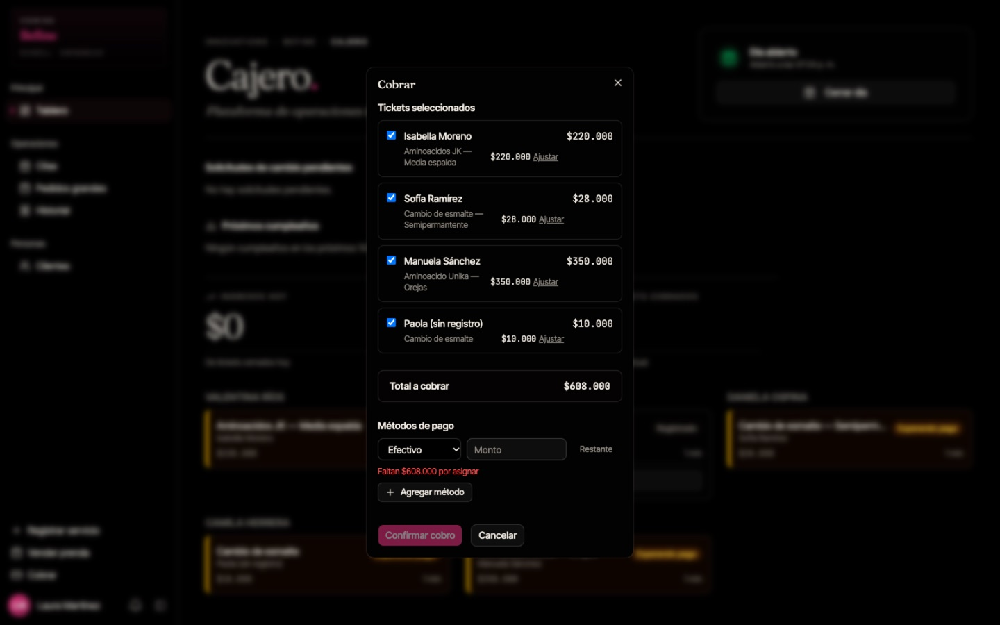

3. Revisa el **Total a cobrar**.
4. En **Métodos de pago** elige el método (Efectivo, Tarjeta o Transferencia) y escribe el **Monto**.
   - Si paga todo con un solo método, toca **"Restante"** para llenar el monto automáticamente.
   - Si paga con dos métodos (ej. parte con tarjeta y parte en efectivo), toca **"Agregar método"**, elige el segundo método y toca **"Restante"**.
   - El texto rojo _"Faltan $… por asignar"_ desaparece cuando los montos suman el total.

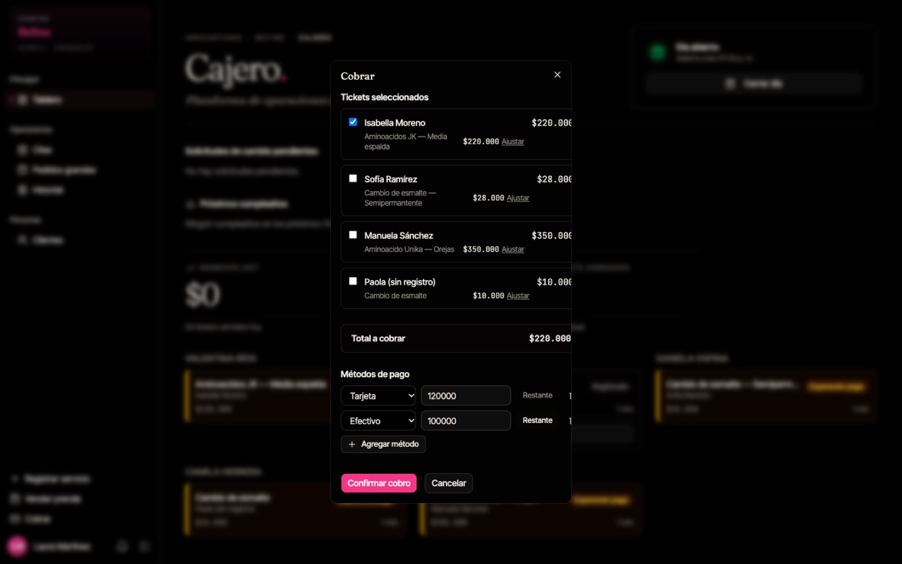

5. Toca **"Confirmar cobro"** y luego **"Confirmar"** en el mensaje _¿Confirmar cobro de $…?_.

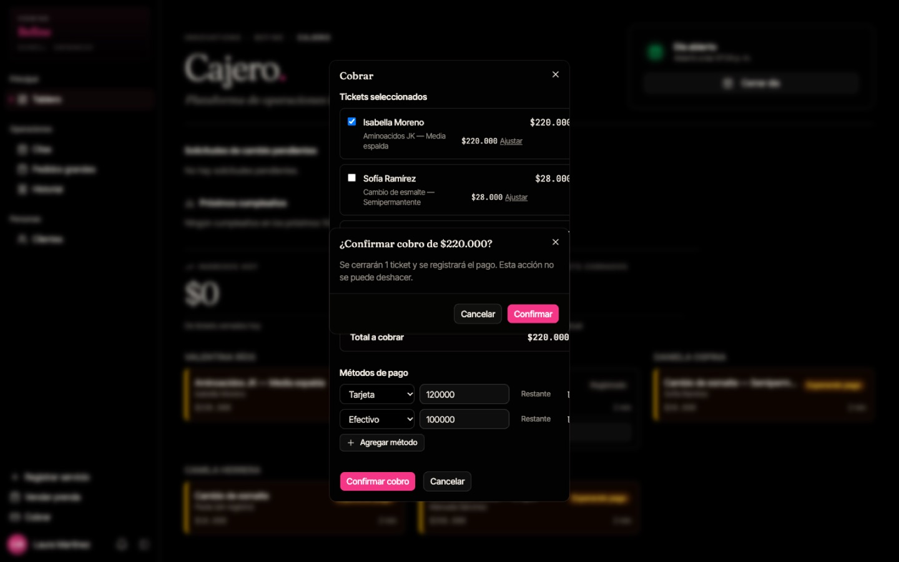

6. El ticket pasa a **Historial** y el valor se suma a **Ingresos hoy**. Si el Tablero no se actualiza de inmediato, recarga la página.

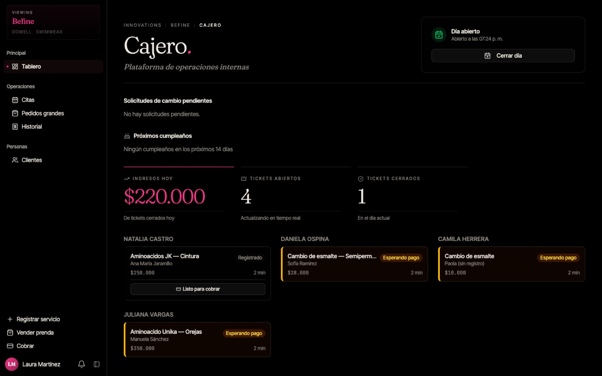

> **Nunca cobres dos veces el mismo ticket.** Si tienes dudas, revisa **Historial** antes de repetir.

### Ajustar el precio de un servicio

Para cortesías o descuentos autorizados:

1. En la ventana **Cobrar**, toca **"Ajustar"** junto al ticket.
2. Escribe el **nuevo precio** y el **motivo** (obligatorio).
3. Toca **"OK"** y espera a que se guarde. Después vuelve a abrir **Cobrar** y continúa normalmente.

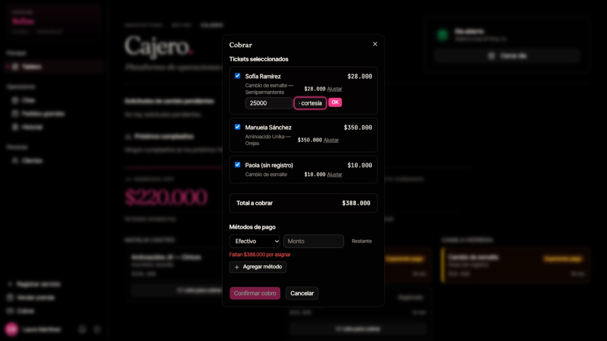

> Los ajustes quedan registrados con tu nombre y el motivo. La comisión de la estilista se calcula sobre el precio ajustado.

---

## 4. Registrar un servicio por una estilista

Si una estilista no tiene el celular a mano, puedes registrar el servicio por ella:

1. Toca **"Registrar servicio"**.
2. En **Empleado** elige la estilista que hizo el servicio.
3. Elige el **Servicio** y la **Variante**; debajo se muestra el precio.
4. En **Cliente**, busca a la clienta por nombre o teléfono. Si no está registrada, toca **"Invitado / Walk-in"**, escribe su nombre y toca **"Confirmar"**.
5. Toca **"Registrar ticket"**.

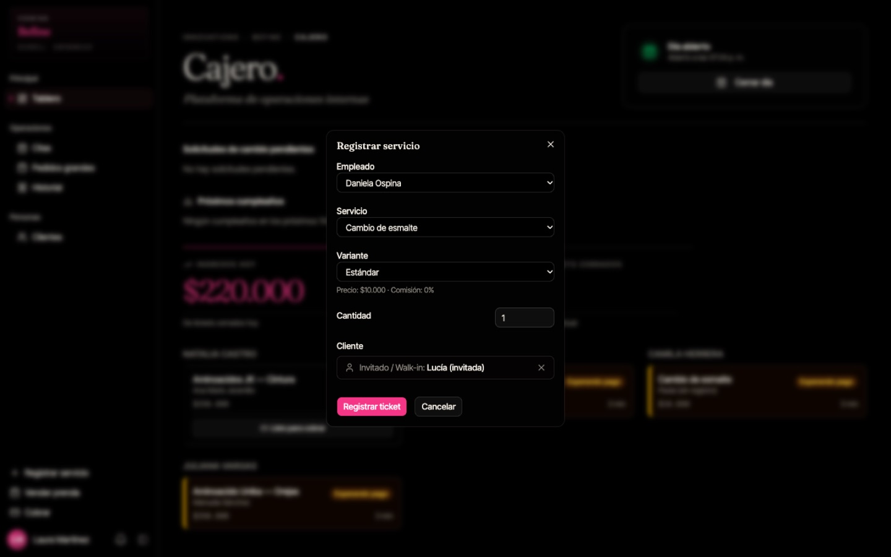

---

## 5. Vender una prenda

Para ventas de prendas de confección en el mostrador:

1. Toca **"Vender prenda"**.
2. Elige la **Prenda** y la **Variante**.
3. Escribe la **Cantidad** y el **Precio unit.** (si la variante dice _"sin precio"_, debes escribirlo).
4. En **Cliente (opcional)** elige **Anónimo**, **Cliente registrado** o **Invitado**.
5. Toca **"Registrar venta"** **una sola vez**. La ventana se limpia cuando la venta queda guardada.

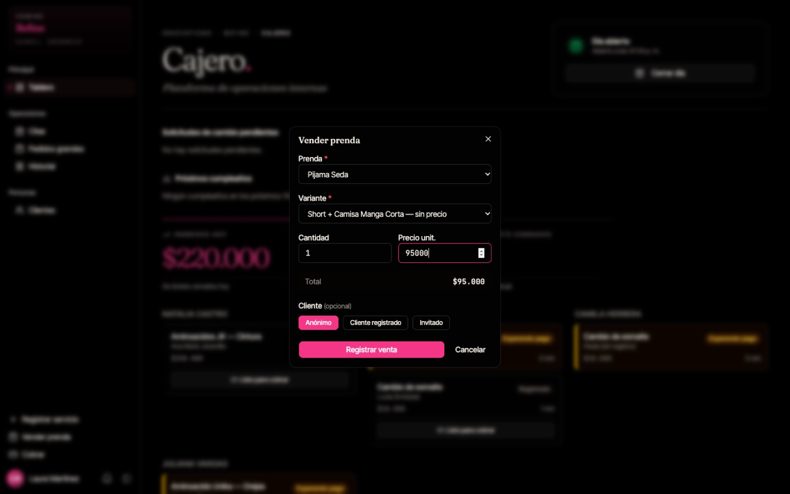

---

## 6. Aprobar solicitudes de cambio

Cuando una estilista registra un servicio con la variante equivocada, envía una **solicitud de cambio**. La verás en el Tablero, en **Solicitudes de cambio pendientes**, con el cambio propuesto (ej. _Hombros → Media espalda_).

- **Aprobar:** el ticket se corrige con la nueva variante y su precio.
- **Rechazar:** el ticket queda como estaba.

Después de aprobar, recarga la página para ver la lista actualizada.

---

## 7. Historial de tickets

Menú → **Historial**. Muestra los tickets cobrados, agrupados por día laboral, con clienta, empleada, servicio, método de pago, total y hora de cierre.

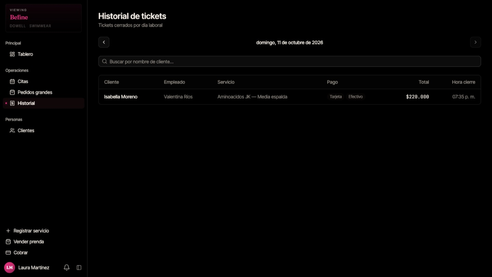

---

## 8. Citas, clientes y pedidos grandes

- **Citas** y **Clientes** funcionan igual que para la secretaria: consulta la [guía de la secretaria](secretary.md#2-agendar-una-cita).
- **Pedidos grandes:** puedes consultarlos, pero solo la secretaria o la administradora los crean y editan.

---

## 9. Cerrar el día (al terminar)

**Antes de cerrar**, revisa el Tablero: **Tickets abiertos debe estar en 0**. Cobra o resuelve cualquier ticket pendiente; los tickets que queden abiertos dejarán de aparecer en el Tablero y en Cobrar después del cierre.

1. Toca **"Cerrar día"**.
2. Confirma en **¿Cerrar el día?** → **"Cerrar día"**.

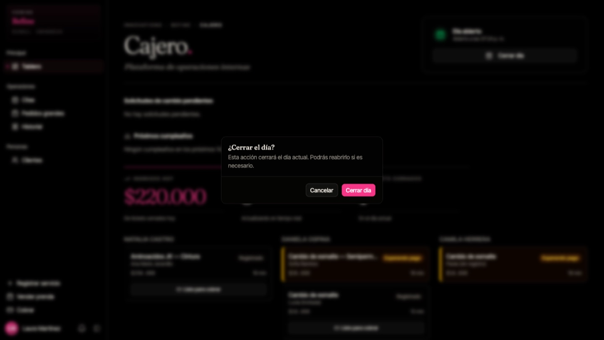

3. El recuadro muestra **Día cerrado** y la hora del último cierre.

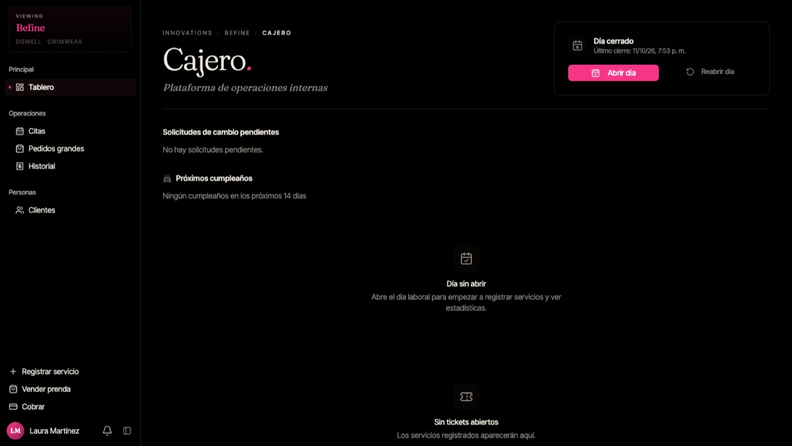

---

## Preguntas frecuentes

**El botón "Abrir día" gira y no pasa nada.** Espera unos segundos y recarga la página antes de volver a tocarlo.

**La ventana Cobrar tarda en abrir.** Es normal que tarde unos segundos; no la cierres ni la abras de nuevo.

**Una clienta paga con dos tarjetas.** Usa **"Agregar método"** y elige **Tarjeta** dos veces con el monto de cada una.

**¿Puedo borrar un cobro?** No. Los cobros no se borran. Si hubo un error, avisa a la administradora.
