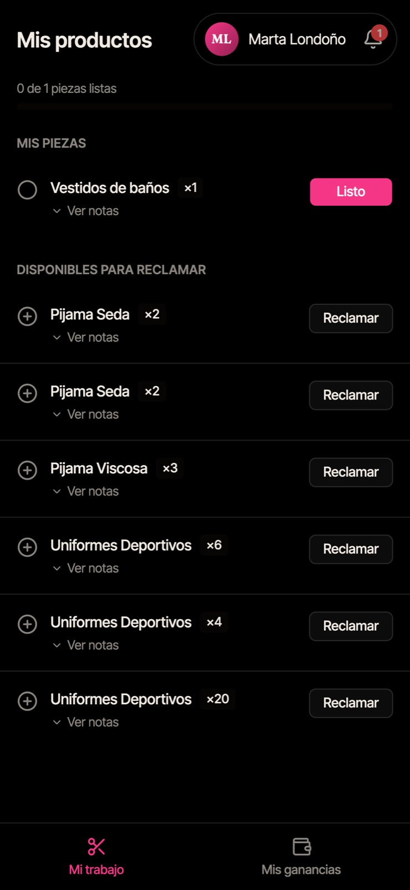
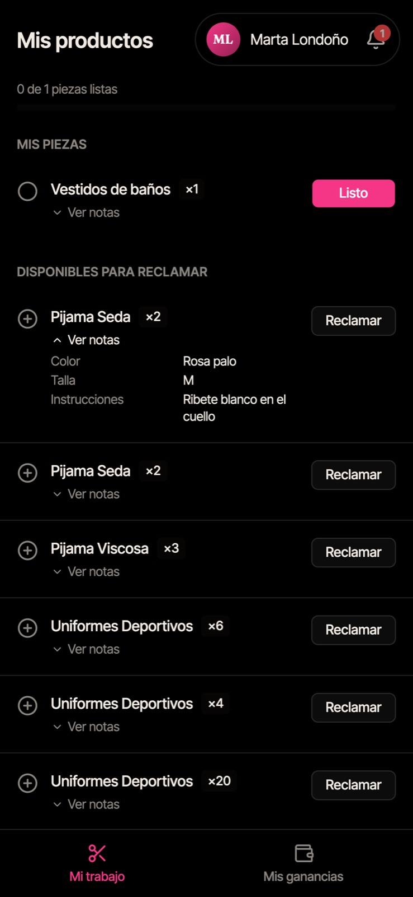
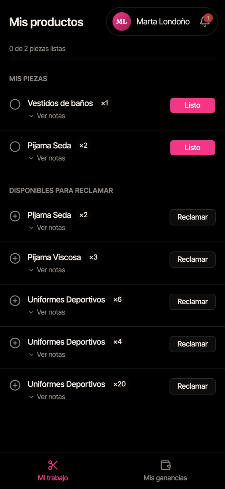
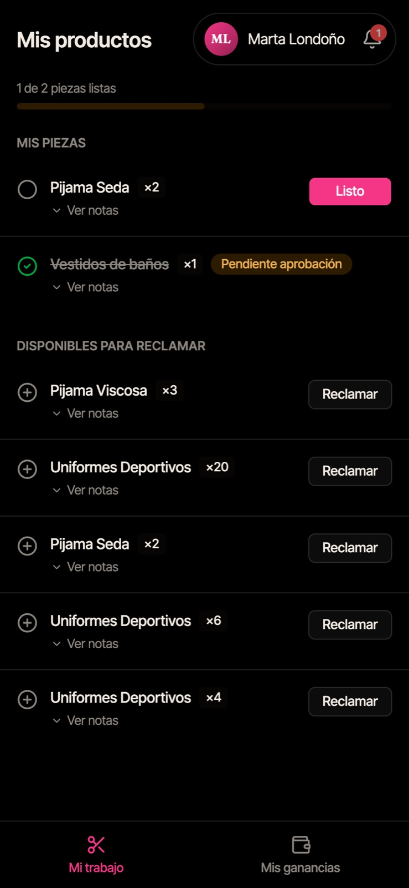
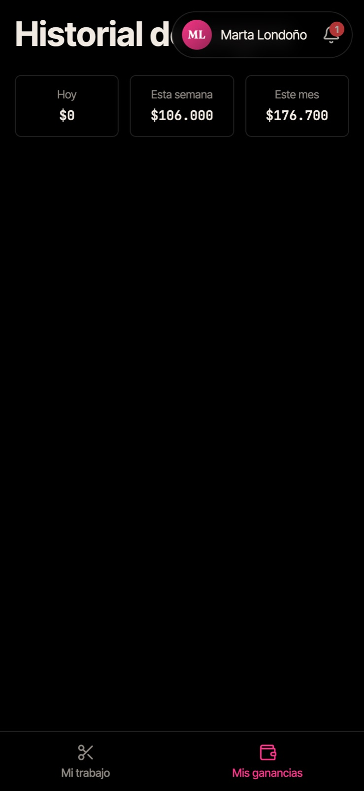

# Guía de uso — Confeccionista

> Lectura rápida: ~3 minutos. Antes, lee [Primeros pasos](common.md).

La app de la confeccionista está hecha para el celular. Abajo tienes dos pestañas: **Mi trabajo** y **Mis ganancias**.

---

## 1. Mi trabajo

Al entrar ves **Mis productos**, con dos listas:

- **Mis piezas:** las piezas que te asignaron o que reclamaste. Arriba ves tu avance (_"1 de 2 piezas listas"_).
- **Disponibles para reclamar:** piezas sin dueña que cualquier confeccionista puede tomar.

El número junto a cada pieza (ej. **×3**) es la cantidad que hay que hacer.

La campana 🔔 te avisa cuando te asignan piezas nuevas (_"Tienes 1 pieza asignada en el nuevo lote"_).

---

## 2. Ver las instrucciones

Toca **"Ver notas"** debajo de la pieza para ver la variante, el color, la talla, el estilo y las instrucciones especiales.

---

## 3. Reclamar una pieza

1. En **Disponibles para reclamar**, toca **"Reclamar"** en la pieza que vas a hacer.
2. La pieza pasa a **Mis piezas**.

> Si otra compañera la reclamó un segundo antes, verás el mensaje _"Esta pieza ya fue reclamada por otro confeccionista"_. Elige otra.
> Reclama solo lo que vas a hacer ahora, así las demás pueden tomar el resto.

---

## 4. Marcar una pieza como lista

Cuando terminas **toda la cantidad** de la pieza:

1. Toca **"Listo"**.
2. La pieza queda tachada con la etiqueta **Pendiente aprobación**.
3. La administradora la revisa y la aprueba. Cuando se aprueba, se suma a tus ganancias.

> **"Listo" se aplica de inmediato y no pide confirmación.** Tócalo solo cuando la pieza esté realmente terminada.

---

## 5. Mis ganancias

Pestaña **Mis ganancias**: lo ganado **hoy**, **esta semana** y **este mes** por las piezas aprobadas, y el historial de pagos.

---

## Preguntas frecuentes

**Toqué "Listo" por error.** Avisa a la administradora o a la secretaria antes de que la aprueben.

**No veo ninguna pieza.** Puede que aún no hayan creado productos hoy o que la cajera no haya abierto el día. Pregunta a la secretaria.

**¿Cuánto me pagan por pieza?** Cada tipo de pieza tiene un valor fijo definido por la administradora en el catálogo.
