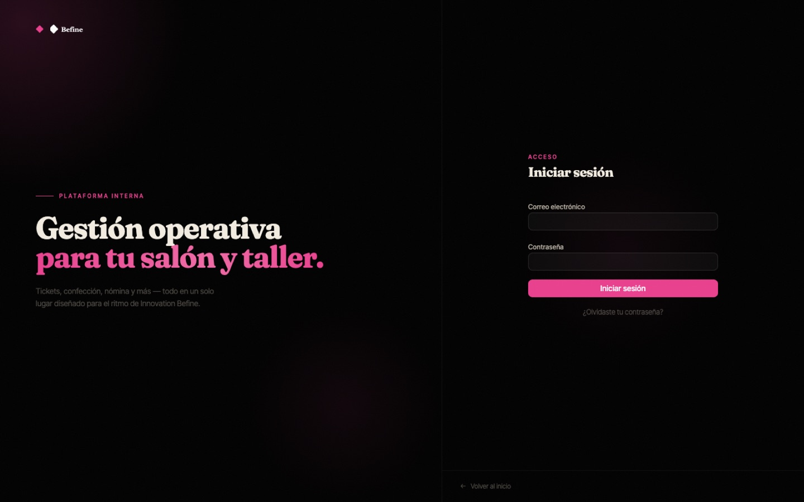
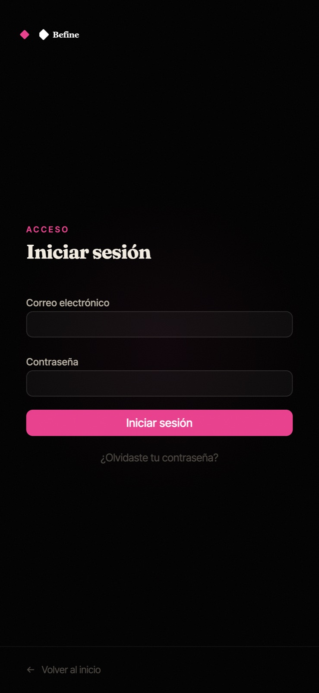
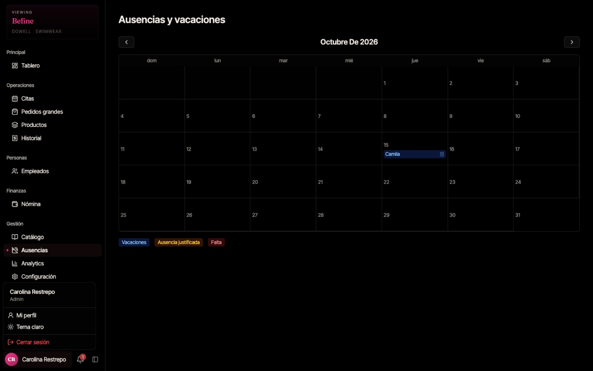
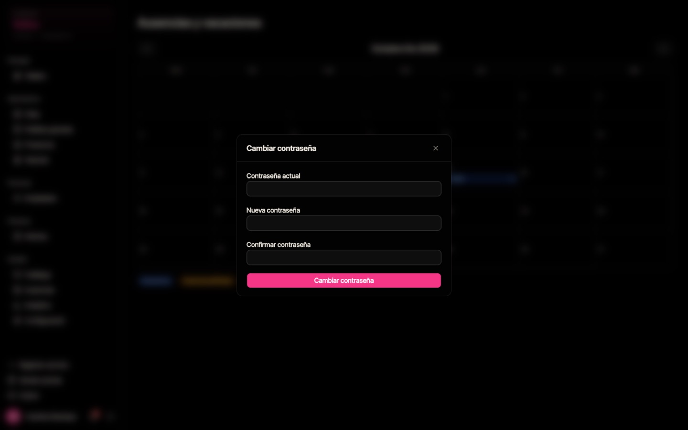

# Primeros pasos — para todo el equipo

> Lectura rápida: ~3 minutos. Léela antes de la guía de tu rol.

La app de BeFine funciona en el navegador del computador de caja y en el celular. No hay que instalar nada: abre el enlace que te dio la administradora y guárdalo en favoritos (en el celular puedes usar **"Agregar a pantalla de inicio"**).

### Tener la app en el celular

Así la abres con un toque, a pantalla completa, como cualquier otra app.

**iPhone** — el iPhone no muestra un aviso para instalarla; hay que hacerlo a mano y **solo funciona desde Safari** (no desde Chrome ni Instagram):

1. Abre el enlace de la app en **Safari** e inicia sesión.
2. Toca el botón **Compartir** (el cuadro con la flecha hacia arriba, abajo en el centro).
3. Desliza y toca **"Agregar a pantalla de inicio"** → **"Agregar"**.
4. Desde ahora abre BeFine con el ícono nuevo de tu pantalla de inicio.

**Android** — en **Chrome**, toca el menú **⋮** (arriba a la derecha) → **"Instalar app"** o **"Agregar a pantalla principal"**. Si Chrome muestra el aviso **"Instalar"**, también sirve.

> **Bueno saber:** las notificaciones de BeFine aparecen dentro de la app (la campana), no como avisos del celular. Si la app se ve desactualizada, ciérrala del todo y ábrela otra vez.

---

## 1. Iniciar sesión

1. Abre la app. Verás la pantalla **Iniciar sesión**.
2. Escribe tu **correo electrónico** y tu **contraseña**.
3. Toca **"Iniciar sesión"**.

La app te lleva directo a tu pantalla según tu rol (cajera, secretaria, estilista, confeccionista o administradora).

En el celular la pantalla se ve así:

> **¿Olvidaste tu contraseña?** Toca **"¿Olvidaste tu contraseña?"** y sigue el enlace que llega a tu correo. Si no te llega, pídele a la administradora una contraseña temporal.

> Tu sesión dura 15 días. No necesitas iniciar sesión cada día en tu propio celular.

---

## 2. Tu menú de usuario

Abajo a la izquierda (computador) o arriba a la derecha (celular) aparece tu nombre. Tócalo para abrir el menú:

- **Mi perfil** — cambiar tu contraseña.
- **Tema claro / Tema oscuro** — cambia los colores de la pantalla.
- **Cerrar sesión** — úsalo siempre en computadores compartidos.

---

## 3. Cambiar tu contraseña

1. Menú de usuario → **Mi perfil**.
2. Escribe tu **contraseña actual**, la **nueva** y confírmala.
3. Toca **"Cambiar contraseña"**.

> Cambia la contraseña temporal la primera vez que entres.

---

## 4. Notificaciones

La campana 🔔 junto a tu nombre muestra avisos nuevos (por ejemplo, _"Nueva cita reservada"_ o _"Tienes 1 pieza asignada en el nuevo lote"_). El número rojo indica cuántos avisos no has leído. Tócala para verlos.

---

## 5. Consejos generales

- **Mensajes de confirmación:** después de guardar algo aparece un aviso verde abajo a la derecha. Si aparece en rojo, lee el mensaje: te dice qué falta o qué salió mal.
- **Si no ves un cambio que acabas de guardar**, recarga la página (en el celular, desliza la pantalla hacia abajo). **No lo registres dos veces.**
- **Precios:** todos los valores están en pesos colombianos, sin centavos (ej. `$45.000`).
- **Horario:** la app usa la hora de Colombia.
- Si algo no funciona, toma una foto de la pantalla y envíasela a la administradora.
