# Guía de uso — Secretaria

> Lectura rápida: ~8 minutos. Antes, lee [Primeros pasos](common.md).

La secretaria agenda citas, registra clientas, crea los productos que fabrica el taller y gestiona los pedidos grandes. Trabaja principalmente en el computador.

**Tu menú lateral:** Tablero · Citas · Pedidos grandes · Productos · Clientes · Mis ganancias. Abajo tienes los botones rápidos **Registrar servicio** y **Vender prenda** (funcionan igual que en la [guía de la cajera](cashier.md)).

---

## 1. Tu Tablero

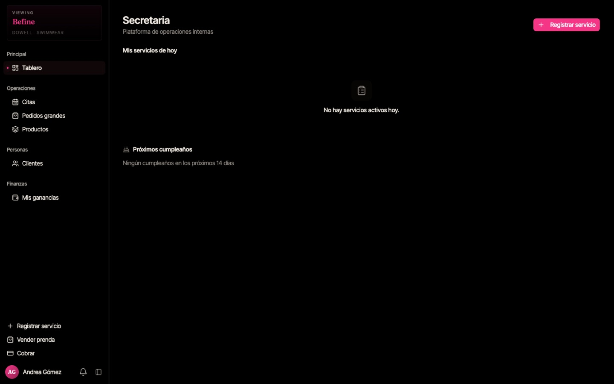

- **Registrar servicio:** registra un servicio a nombre de una estilista (igual que en la [guía de la cajera](cashier.md#4-registrar-un-servicio-por-una-estilista)).
- **Mis servicios de hoy:** lo que registraste hoy.
- **Próximos cumpleaños:** clientas que cumplen años en los próximos 14 días; ideal para enviarles un saludo o una promoción.

---

## 2. Agendar una cita

1. Menú → **Citas** → **"Nueva cita"**.
2. **Cliente:** escribe el nombre, teléfono o correo y elige a la clienta de la lista.
   - Si es nueva, toca **"Nuevo cliente"**.
   - Si no quiere registrarse, toca **"Invitado / Walk-in"** y escribe su nombre.
3. **Estilista:** elige quién la atenderá.
4. **Descripción del servicio:** ej. _"Corte y cepillado"_.
5. **Fecha y hora** y **Duración (minutos)**.
6. Toca **"Reservar cita"**. Aparece el aviso _"Cita reservada correctamente"_ y la estilista recibe una notificación.

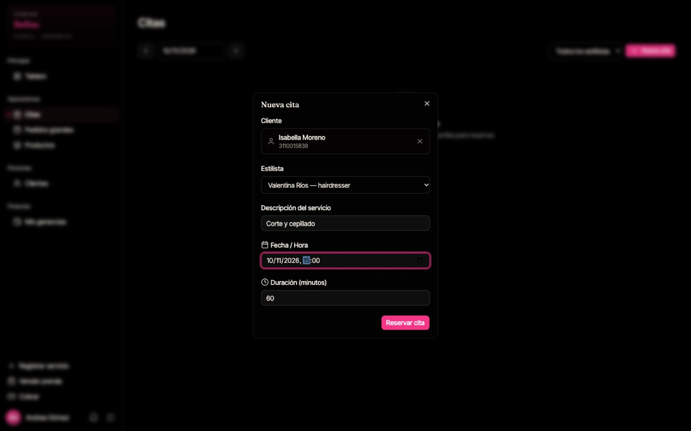

> Si la nueva cita no aparece en la lista, recarga la página. **No la reserves dos veces.**
> El sistema no deja reservar dos citas a la misma estilista en horarios que se cruzan.

---

## 3. Gestionar las citas del día

En **Citas** ves la agenda del día elegido. Usa las flechas **‹ ›** para cambiar de día y **"Todos los estilistas"** para filtrar por estilista.

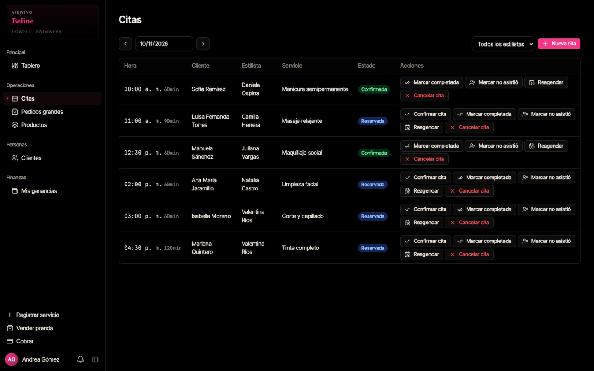

Cada cita tiene un **estado** y botones de acción:

| Acción                | Cuándo usarla                                                |
| --------------------- | ------------------------------------------------------------ |
| **Confirmar cita**    | La clienta confirmó por teléfono o WhatsApp → _Confirmada_.  |
| **Marcar completada** | La clienta ya fue atendida.                                  |
| **Marcar no asistió** | La clienta no llegó. Queda en su historial de inasistencias. |
| **Reagendar**         | Cambiar fecha u hora.                                        |
| **Cancelar cita**     | La clienta canceló. Puedes escribir el motivo.               |

> Marcar la cita como completada **no** cobra el servicio. La estilista (o la cajera) debe registrar el servicio y la cajera lo cobra.

---

## 4. Clientes

Menú → **Clientes**. Busca por nombre, teléfono o correo.

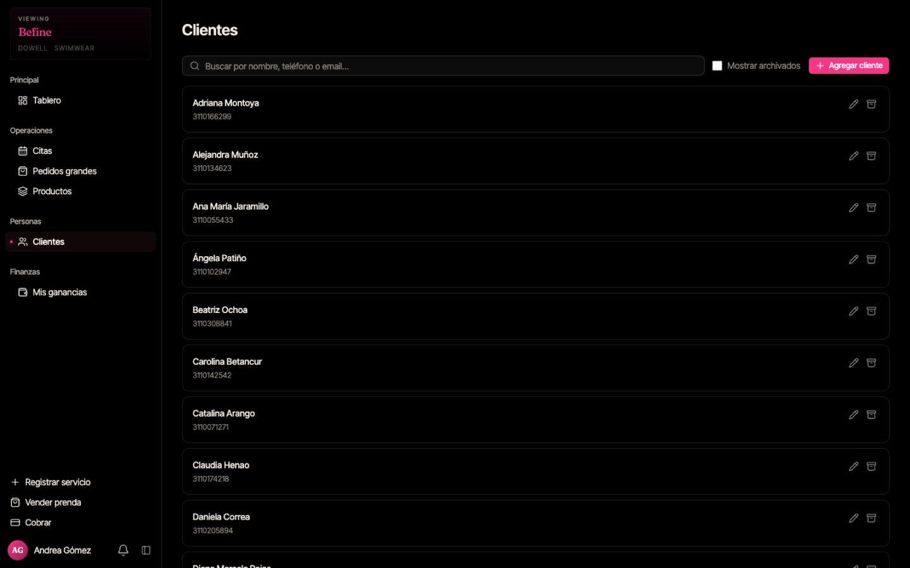

**Agregar una clienta:** **"Agregar cliente"** → Nombre, Teléfono, Email, Notas y fecha de cumpleaños (todo opcional menos el nombre) → **"Crear"**.

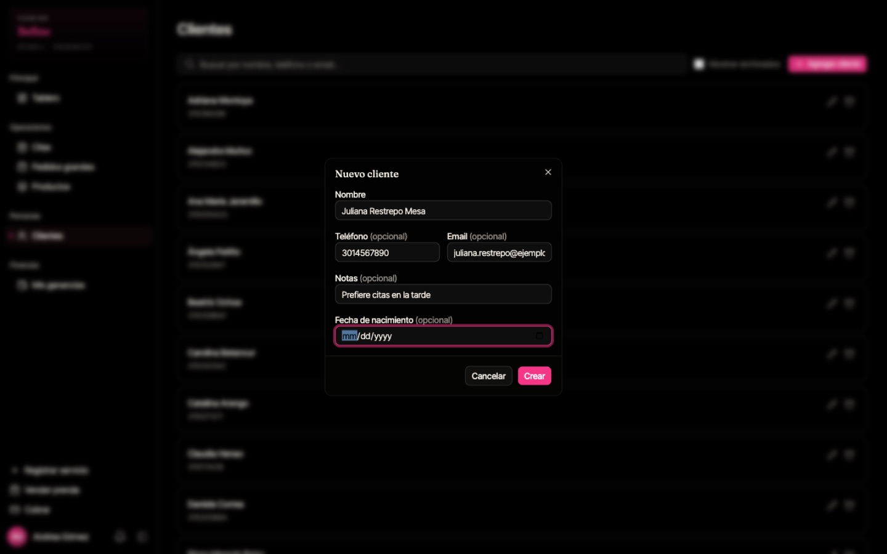

- **Editar cliente:** botón de editar en la fila de la clienta.
- **Archivar:** oculta la clienta de las búsquedas sin borrar su historial. Activa **"Mostrar archivados"** para verla de nuevo.

> Registra el **cumpleaños**: así aparece en _Próximos cumpleaños_.

---

## 5. Productos (trabajo para el taller)

Un **producto** es un encargo para el taller de confección, con una o varias **piezas**. Las confeccionistas ven las piezas en su celular y las reclaman.

### Crear un producto

1. Menú → **Productos** → **"Nuevo producto"**.
2. **Notas (opcional):** ej. _"Pedido mostrador — clienta Sara Valencia"_.
3. Para cada pieza:
   - **Tipo de pieza** y **Variante** (ej. _Pijama Seda — Short + Camisa Manga Corta_).
   - **Cant.**
   - **Asignar a:** elige una confeccionista, o deja **Sin asignar** para que cualquiera la reclame.
   - **Color**, **Estilo**, **Talla** e **Instrucciones** (la confeccionista las ve en _Ver notas_).
4. **"Agregar pieza"** para añadir otra.
5. Toca **"Crear producto"**.

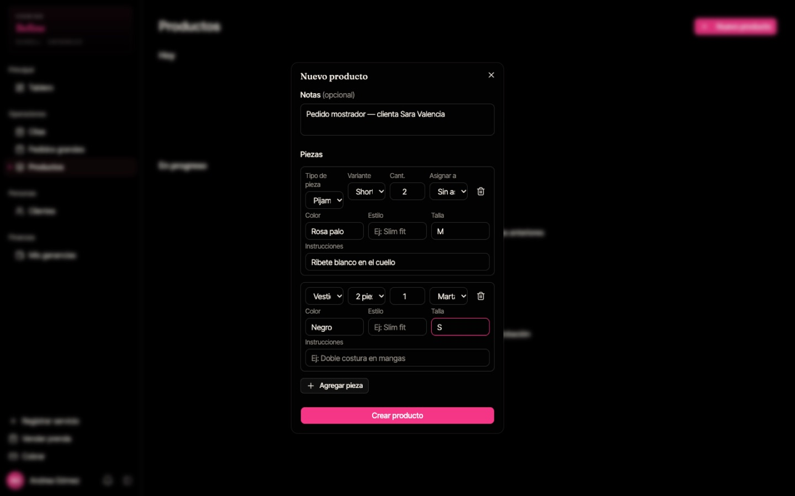

### Seguir el avance

La lista muestra los productos de **Hoy** y los que siguen **En progreso** de días anteriores, con quién los tiene asignados y el porcentaje de avance.

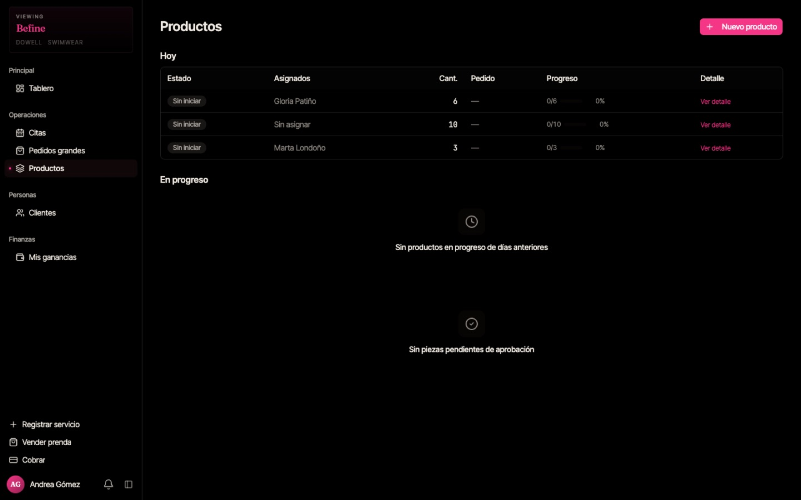

Toca **"Ver detalle"** para ver cada pieza, su confeccionista y su estado. Con el lápiz puedes corregir cantidad, color, talla o instrucciones.

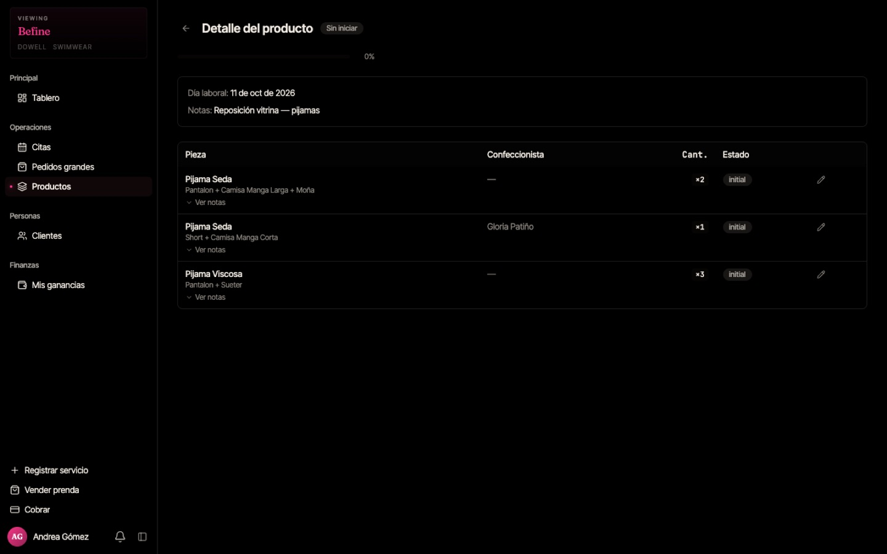

Cuando una confeccionista marca una pieza como lista, queda **Pendiente aprobación** y la administradora la aprueba (ver [guía de la administradora](admin.md#3-aprobar-piezas-terminadas)).

---

## 6. Pedidos grandes

Para encargos grandes de una clienta (uniformes, dotaciones, etc.) con abonos.

### Crear un pedido

1. Menú → **Pedidos grandes** → **"Nuevo pedido"**.
2. **Cliente** (obligatorio).
3. **Artículo 1:** tipo de pieza, variante, cantidad, descripción (ej. _"escudo bordado en pecho izquierdo"_), color, estilo, talla e instrucciones. Usa **"Agregar artículo"** para más.
4. **Precio total** y **fecha de entrega**.
5. **Notas internas** (opcional).
6. Si la clienta deja un abono, marca **"Depósito inicial"**, escribe el monto y el método de pago.
7. Toca **"Guardar pedido"**.

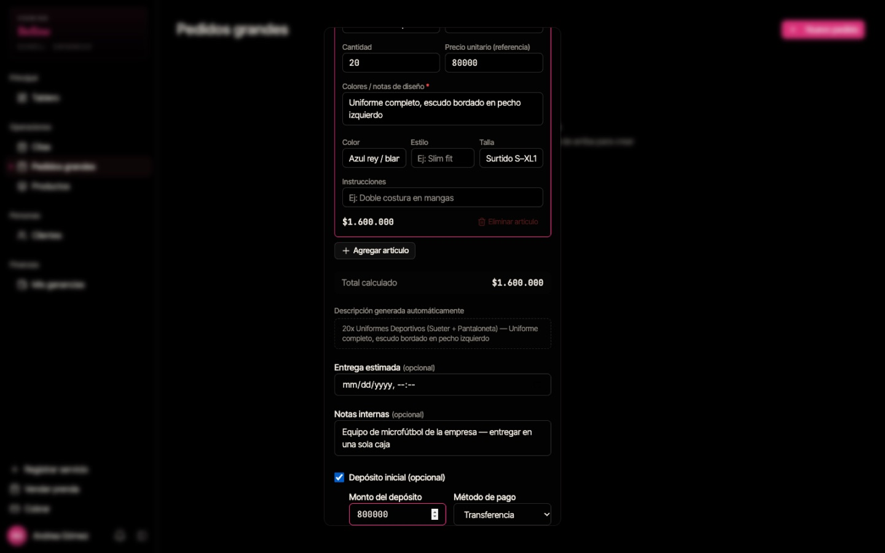

### Detalle del pedido

Después de guardar se abre el detalle: artículos, **Resumen financiero** (precio total, pagado y saldo pendiente) y pagos registrados.

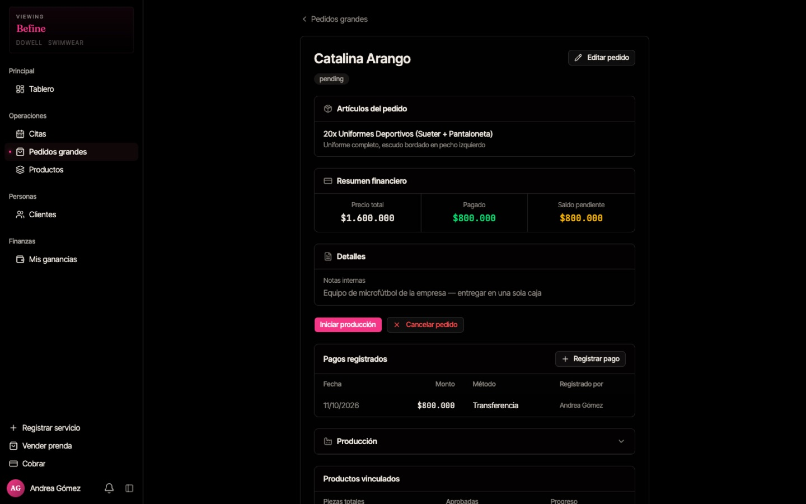

- **"Iniciar producción":** envía el pedido al taller. Las piezas aparecen en el celular de las confeccionistas para reclamarlas.
- **"Registrar pago":** registra cada abono nuevo.
- **"Editar pedido"** / **"Cancelar pedido"**.
- **Producción:** muestra cuántas piezas hay y cuántas están aprobadas.

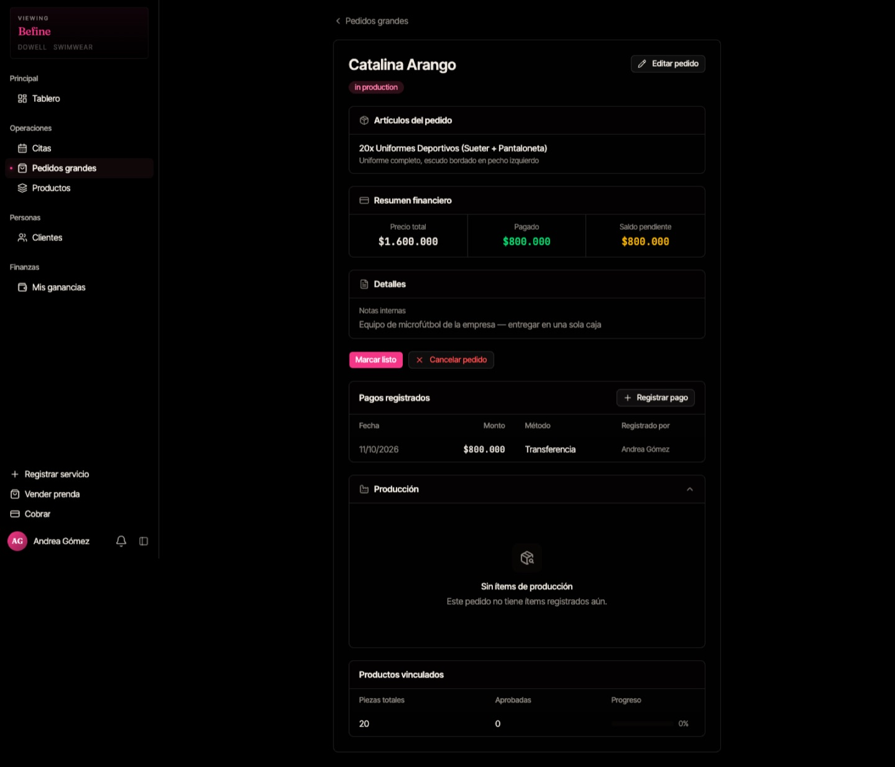

La lista de **Pedidos grandes** muestra todos los pedidos y su estado:

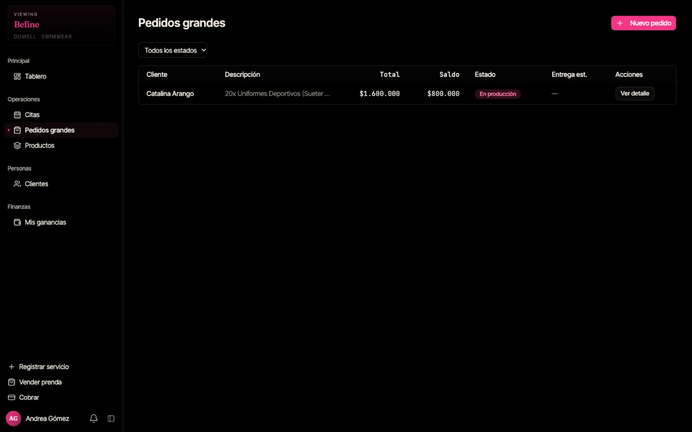

---

## 7. Mis ganancias

Menú → **Mis ganancias**: lo que llevas ganado **hoy**, **esta semana** y **este mes** según tu tarifa diaria, y el historial de pagos recibidos.

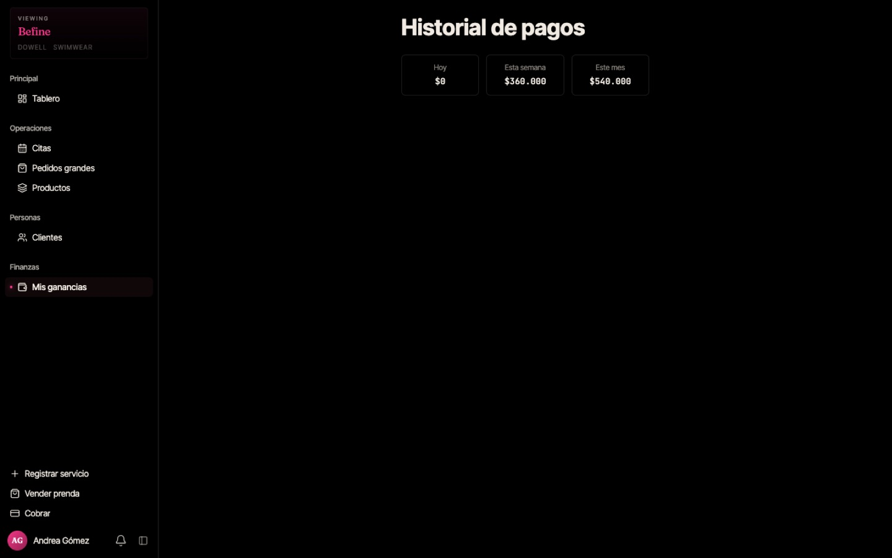

---

## Preguntas frecuentes

**Guardé una cita o un producto y no aparece.** Recarga la página; casi siempre ya quedó guardado.

**¿Puedo cobrar?** No. Los cobros los hace la cajera o la administradora. Tú sí puedes registrar servicios y vender prendas.

**Una clienta pidió cambiar la talla de una pieza.** Productos → **Ver detalle** → lápiz de la pieza.
