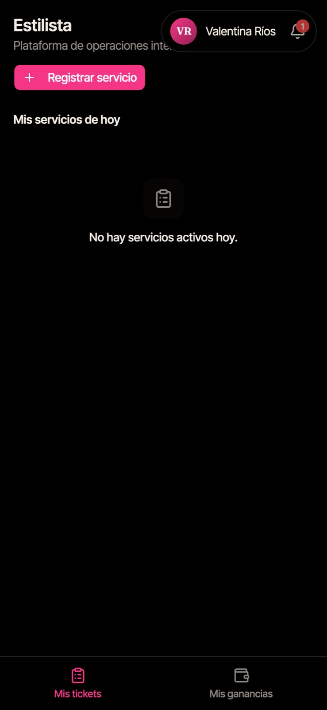
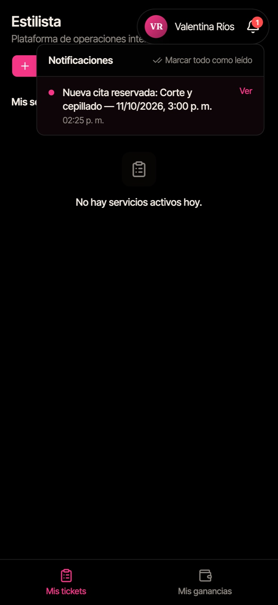
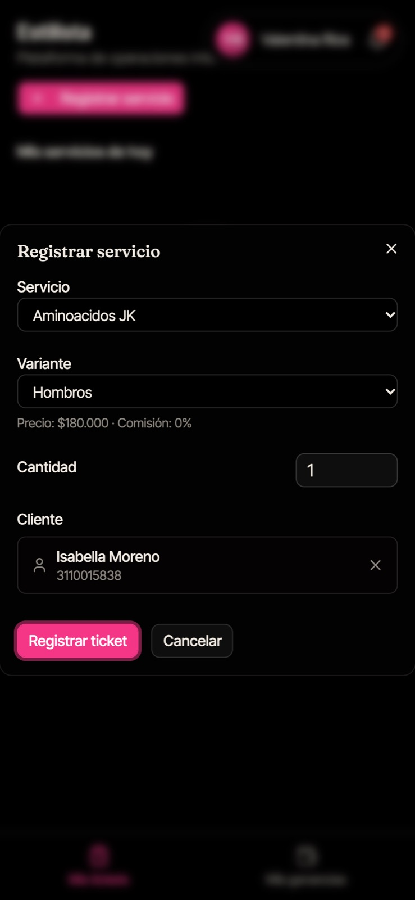
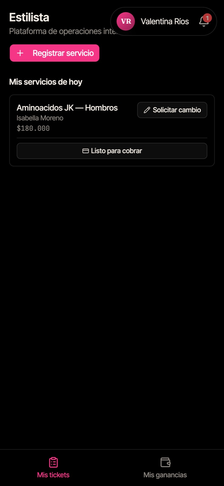
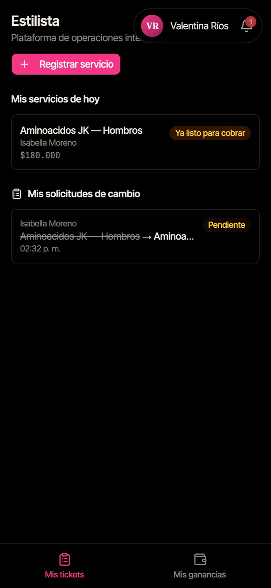
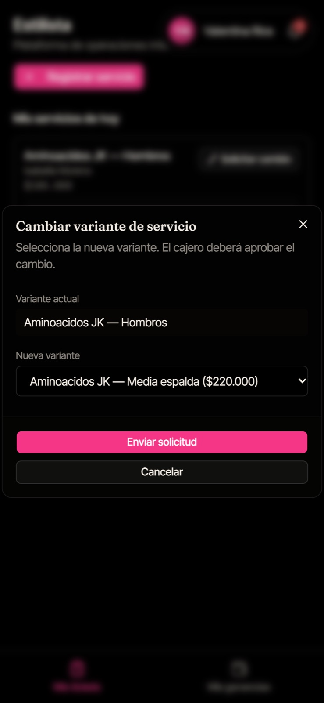
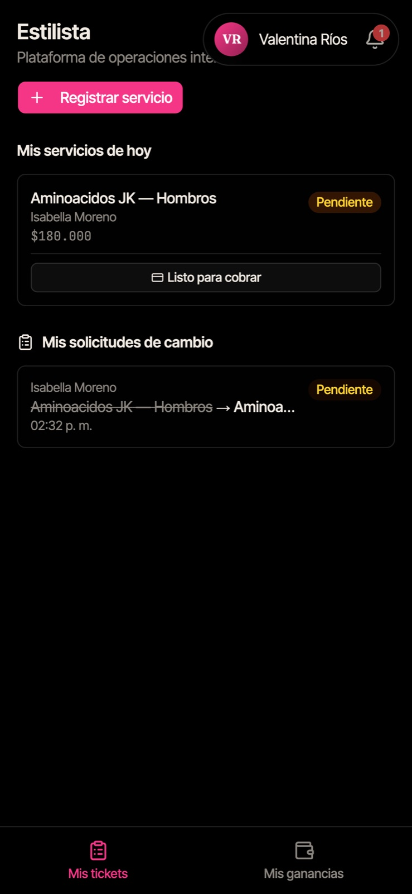
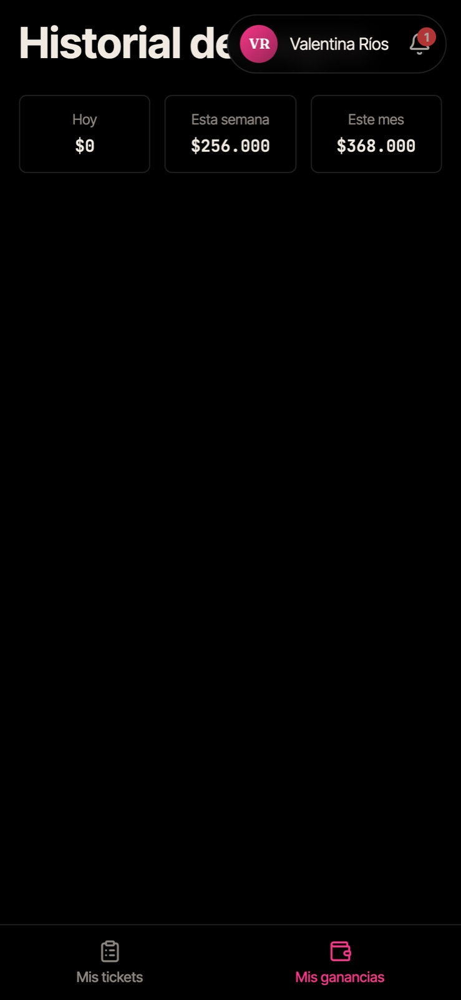

# Guía de uso — Estilista

> Lectura rápida: ~4 minutos. Antes, lee [Primeros pasos](common.md).

La app de la estilista está hecha para el celular. Abajo tienes dos pestañas: **Mis tickets** y **Mis ganancias**.

---

## 1. Tu pantalla de inicio

Al entrar ves **Mis servicios de hoy**: los servicios que registraste hoy y su estado. Arriba está el botón **"Registrar servicio"**.

La campana 🔔 te avisa cuando la secretaria te agenda una cita (ej. _"Nueva cita reservada: Corte y cepillado — 3:00 p. m."_).

---

## 2. Registrar un servicio

Hazlo **cuando empiezas a atender** a la clienta.

1. Toca **"Registrar servicio"**.
2. Elige el **Servicio** y la **Variante**. Debajo verás el **precio** y tu **comisión**.
3. Deja **Cantidad** en 1 (cámbiala solo si haces el mismo servicio varias veces).
4. **Cliente:** escribe el nombre o teléfono y elige a la clienta. Si no está registrada, toca **"Invitado / Walk-in"** y escribe su nombre.
5. Toca **"Registrar ticket"**.

El servicio aparece en **Mis servicios de hoy**.

> **Si el servicio no aparece en la lista, desliza la pantalla hacia abajo para recargar. No lo registres otra vez:** se crearía un cobro duplicado.

---

## 3. Marcar "Listo para cobrar"

Cuando terminas y la clienta va a pagar:

1. Busca el servicio en **Mis servicios de hoy**.
2. Toca **"Listo para cobrar"**.
3. El servicio queda como **Ya listo para cobrar** y le aparece a la cajera.

> Tú no cobras: eso lo hace la cajera.

---

## 4. Corregir un servicio (solicitar cambio)

Si elegiste la variante equivocada (ej. _Hombros_ en vez de _Media espalda_):

1. En el servicio, toca **"Solicitar cambio"**.
2. En **Nueva variante** elige la correcta (se muestra su precio).
3. Toca **"Enviar solicitud"**.

El servicio queda **Pendiente** y abajo aparece en **Mis solicitudes de cambio** hasta que la cajera o la administradora lo apruebe o rechace.

---

## 5. Mis ganancias

Pestaña **Mis ganancias**: tus comisiones de **hoy**, **esta semana** y **este mes**, y el historial de pagos que te ha hecho la administradora.

> Las ganancias de hoy se suman cuando la cajera cobra el servicio, no cuando lo registras.

---

## Preguntas frecuentes

**¿Puedo registrar un servicio de otra estilista?** No. Cada estilista registra solo los suyos. La cajera o la secretaria pueden registrarlo por ti.

**Me equivoqué de clienta o de servicio.** Usa **"Solicitar cambio"**. Si es otro error, avisa a la cajera; no crees un ticket nuevo.

**No veo "Registrar servicio" o me sale "No hay un día laboral abierto".** La cajera todavía no ha abierto el día. Pídele que lo abra.
